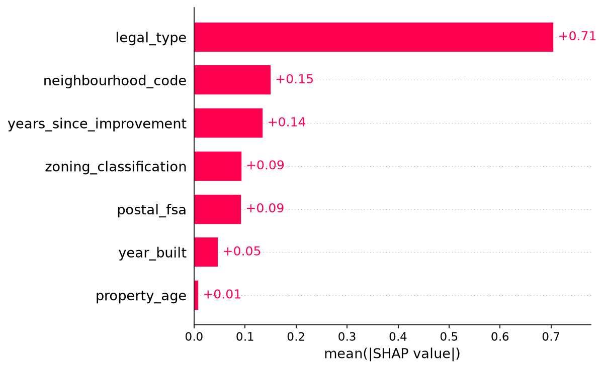

# Vancouver Property Value Predictor

An end-to-end machine learning project: public data → feature engineering → baselines vs. model → SHAP explainability → deployed Streamlit app.

**Live demo:** https://vancouver-property-predictor.streamlit.app

## Problem
Predict the BC Assessment value of a property in the City of Vancouver from its type (strata/land), zoning, neighbourhood, postal area, and age.

## Data
City of Vancouver Open Data **Property Tax Report** (Open Government Licence – Vancouver), sourced from BC Assessment records. The latest report year is used. `train.py` downloads it automatically; if that fails, export the CSV from the portal and save it as `data/property-tax-report.csv`.

- Target: `current_land_value + current_improvement_value` (modelled on a log scale).
- Leakage avoided: previous-year values and `tax_levy` are **not** used as features.

## Approach
- Features: property type, zoning classification, neighbourhood code, postal FSA, year built, property age, years since major improvement.
- Baselines: overall median, and median by neighbourhood + property type.
- Models: Ridge regression and HistGradientBoosting (native categorical handling).
- Metrics: MAE, median absolute % error, R² on log value.

## Results
_Run `python train.py` and paste your real numbers here, e.g.:_
> Gradient boosting reduced MAE by **XX%** vs. the neighbourhood + type median baseline (median error X.X%).

## Explainability (SHAP)
`shap_importance.png` shows which features drive predictions overall, and the app shows a waterfall chart for each individual prediction.



_Add your key finding, e.g. "Neighbourhood and property type were the strongest drivers."_

## Limitations
- City of Vancouver only, not all of British Columbia.
- Assessed values approximate market value but are not sale prices.
- No square footage, lot size, or bedroom data in the open dataset.
- Neighbourhood names are not provided, only BC Assessment codes.

## Run locally
```bash
pip install -r requirements.txt
python train.py
streamlit run app.py
```

## Deploy (free)
1. Commit the generated `model.joblib`, `metrics.json`, and the SHAP images (and `data/` is optional) to a GitHub repo.
2. On share.streamlit.io, create an app from the repo with `app.py` as the main file.
3. Paste the live URL at the top of this README and on your resume.

## Ideas to extend
- Add Vancouver's parcel polygons or lat/long for a map and spatial features.
- Add census or transit-distance features.
- Compare against LightGBM/XGBoost and tune with Optuna.
